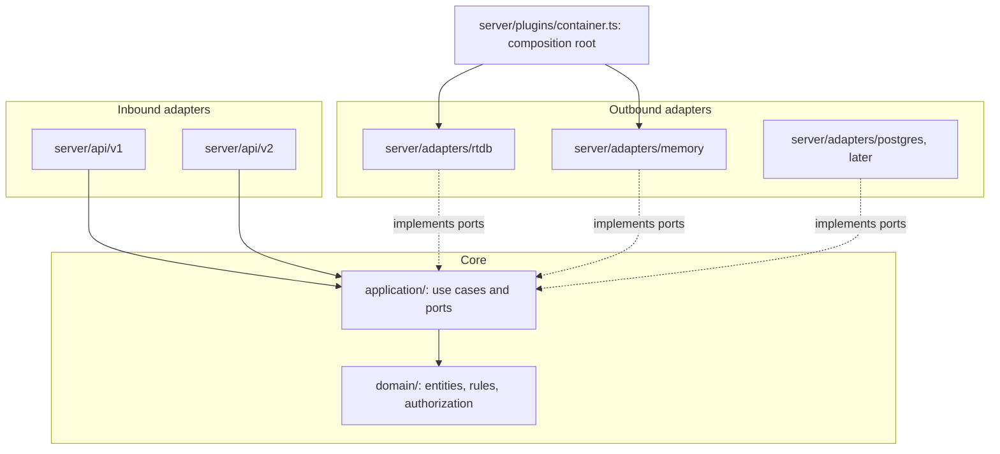

# Architecture

How the site is put together today, the shape it is moving towards, and the rules that keep the two
apart while both exist. The domain-driven design is implemented as a **hexagonal architecture**
(ports and adapters); that is the only target layout for new server code. The reasoning behind the direction is on the wiki's "Domain-driven design" and
"Access control" pages; the work itself is tracked in the milestones _Domain-driven architecture_,
_API and presentation boundaries_ and _PostgreSQL migration_.

## Today

```
Browser (Vue pages, Pinia stores, Firebase Auth client)
   │  fetch /api/v1/*   (Firebase ID token in a header or cookie)
   ▼
Nitro server
   server/middleware/00.wideEvent.ts   one structured log record per request
   server/middleware/auth.ts           verifies the ID token
   server/middleware/user.ts           builds event.context.subject, and keeps event.context.user for v1
   server/api/v1/**                    handlers: validate, authorize, read and write Firebase
   ▼
Firebase Admin SDK: Realtime Database, Cloud Storage, Auth
```

- The browser uses Firebase only to sign in. Every database and storage call happens on the server,
  so the data store can change without touching the front end.
- Handlers mix request parsing, rules, authorization (`hasAccess`) and storage calls in one function.
  That is what the migration removes.
- Realtime Database nodes: `users`, `companies`, `events` (with `attendants` and `queue`), `jobs`,
  `registrationCodes`, `studyProgrammes`, `generalInfo`. The stored data has drifted from the types
  in `models/` (#543); treat what is stored as untrusted and parse it.

## Target: hexagonal architecture

The domain and the use cases sit in the middle and know nothing about Nitro, Firebase or
SQL. The outside talks to the middle through ports, which are TypeScript interfaces, and adapters
implement them. One composition root chooses the adapters.



| Directory                               | Holds                                                            | May import                      |
| --------------------------------------- | ---------------------------------------------------------------- | ------------------------------- |
| `domain/`                               | Entities, value objects, rules, permission table                 | Only `domain/`                  |
| `application/`                          | Use cases, and the ports they need                               | `domain/`, `application/`       |
| `server/adapters/`                      | Port implementations for each store                              | `domain/`, `application/`, SDKs |
| `server/api/`                           | Route handlers: parse, call one use case, map the result to HTTP | Everything above                |
| `server/plugins/container.ts` (planned) | Builds adapters once and puts them on the request                | Everything above                |

Dependency injection is plain functions: a use case takes its ports as arguments. There is no DI
framework.

`tests/architecture.spec.ts` fails the build if `domain/` or `application/` imports anything
outside the directories allowed above.

The first port is `EventRepository` in `application/events/`. Every adapter for a port must pass
that port's contract suite (`tests/application/**/*.contract.ts`), which the adapter's own test
file runs with a factory. The in-memory adapter is the reference implementation.

A port method performs a whole operation, such as "register or waitlist this user", not a separate
read and write. Each adapter then does it atomically in its own way, and a later PostgreSQL adapter
can replace the Realtime Database one without changing the use cases.

## Authorization

- **v1:** `server/utils/hasAccess.ts` compares the user's single `userType` with a list.
- **Target (ABAC):** a per-request `Subject` (uid, roles, per-company entitlements, and the student
  attributes eligibility may judge) is checked by `hasPermission` against the permission table in
  `domain/authorization`. Roles bundle permissions; companies hold entitlements; a coordinator gets the
  entitlements of each company they are associated with. Event eligibility rules live in
  `domain/authorization/eligibility.ts` and explain refusals. The core is in review in #517. The
  subject is built once per request in `server/middleware/user.ts` (#519). Use cases check it with
  `authorize` in `domain/authorization/authorize.ts`, the one place a denial is raised: status 401
  with `auth/signed-out` when nobody is signed in, 403 with `auth/forbidden` when the table says
  no. The caller passes the clock. #521 moves the remaining v1 handlers off `hasAccess`.

## Logging

Every request produces one wide event: a single structured record carrying everything known about
it. Handlers add to it with `setResourceContext`, `addEventContext`, `setErrorContext` and the
database timing helpers in `server/utils/wideEventHelpers.ts`. Routine reads are not logged; changes,
listings of personal data, warnings, errors and slow requests always are (`server/utils/logger.ts`).

Errors are logged and answered in one place. Code throws `fail(code)` from `domain/errors`, whose
catalogue gives each code its status and developer message. The Nitro error handler in
`server/errors/` records the error, its causes and, for server errors, the stack on the wide event,
and answers API requests with the code and the request id. Anything else that is thrown becomes
`internal/unexpected`. The client translates the code for the user.

## Tests

All tests live under `tests/`, mirroring the source path.

| Layer      | Covers                                                                  | Status                 |
| ---------- | ----------------------------------------------------------------------- | ---------------------- |
| Unit       | Domain rules and use cases, using in-memory adapters                    | In place for `domain/` |
| Contract   | One suite per port that every adapter must pass                         | Planned                |
| API        | Every endpoint's status codes and bodies against the Firebase emulators | Started with events    |
| End to end | A few user journeys in a browser                                        | Planned                |

Replace a port with an in-memory adapter in tests; do not mock the domain.

## Where the migration stands

1. Domain layer: merged (#515).
2. ABAC core: in review (#517). Generated API docs (#544) and the release workflow (#545) are also in review.
3. Next: tests that pin down v1 behaviour, then events and registration as the first feature running
   through ports, use cases and an RTDB adapter (#518–#520, #523–#525).
4. Then API v2, one domain at a time (#534, #533, #522, #521).
5. Later: Docker for local development, a move off App Platform, PostgreSQL and backups (#526–#532).

While both shapes exist: new rules go in `domain/`, new endpoints use the target layout, and v1
handlers only change to fix bugs or to call a use case.
